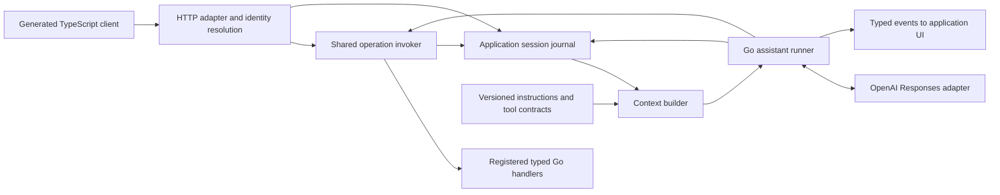
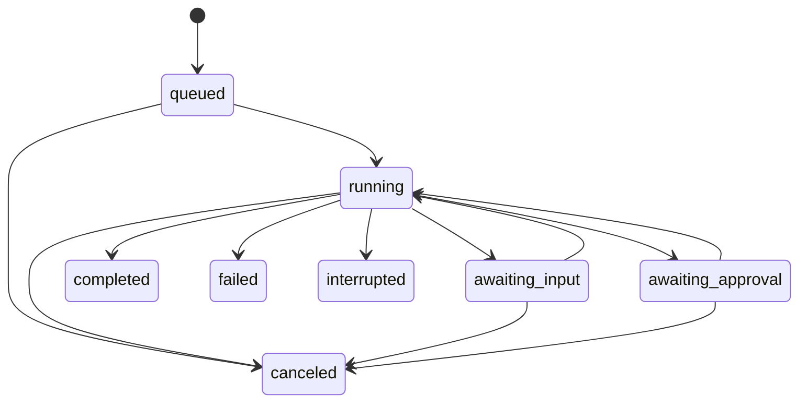

# oneb agent integration: research and design specification

Status: draft for review. Researched on 2026-10-04. No implementation is included.

Scope: the oneb module in this repository.

The product promise is: **register a typed Go handler once, and both the application's user interface and its internal assistant can use it with the same permissions, validation, and results.** Their actions contribute to a shared application session, so the assistant can understand what the user has been doing.

This document distinguishes verified provider behavior from proposed oneb behavior. All API names and code sketches below are proposals, not APIs available in the current code.

## 1. Recommended design

| User requirement | Proposed oneb feature |
| --- | --- |
| Use a ChatGPT subscription in an app | An optional Sign in with ChatGPT integration, separate from application authentication, plus an explicit API billing mode for deployments without subscription access. |
| Record calls made by users and the AI | An application session journal containing HTTP observations and logical handler invocations, including requests, projected results, failures, and actor attribution. |
| Interact intelligently with the assistant | A Go agent runner with streaming progress, application view context, clarification, action previews, cancellation, and typed frontend events. |
| Attach additional prompts easily | Versioned instructions at application, group, and method scope, with separate dynamic context providers. |

Use the OpenAI Responses API with a small Go orchestration loop for the first release. Keep the operation contracts and session history owned by oneb. Agent tools execute inside the backend through the registered handler pipeline. This removes a network round trip for each tool call and avoids maintaining separate AI implementations of business operations.

The initial deployment assumption is that oneb should support both a hosted Go backend and local/personal self-hosted applications. Provider availability must be expressed in configuration; making a Go library open source does not establish eligibility for every application built with it.

## 2. Research findings that affect the design

### 2.1 Sign in with ChatGPT is a real integration option

OpenAI's September 29, 2026 DevDay documentation announces sign-in for external applications and eligible Plus/Pro users bringing their ChatGPT plan to participating apps. Commercial sign-in is currently a limited trial with selected partners; plan usage is available to open-source partners and selected private clients. [DevDay 2026](https://learn.chatgpt.com/docs/whats-new/devday-2026)

There are two separate permissions: identity and ChatGPT plan usage. Identity alone does not authorize inference. Neither grants access to a user's ChatGPT conversations or memories. oneb must create and own its application context. [Sign in with ChatGPT quickstart](https://developers.openai.com/siwc/quickstart), [user-facing explanation](https://learn.chatgpt.com/docs/sign-in-with-chatgpt)

| Deployment | Verified provider path | oneb recommendation |
| --- | --- | --- |
| Eligible open-source/local app | Dynamic OAuth registration and user-authorized plan usage without a partner API key or client secret. | Provide a Go helper for connecting and managing the user's ChatGPT account. |
| Personal self-hosted VM | Complete the same tool's OAuth flow locally, securely transfer its credential record, and let the VM manage refreshes. | Support an explicit credential import workflow and preserve the VM's own host ID. |
| Paid or remotely hosted product | The open-source guide directs these apps to an interest form; selected clients have access. Public documentation does not establish universal self-service SaaS eligibility. | Support application-funded API requests immediately; enable subscription use when that deployment has the appropriate access and documented integration contract. |

The local/hosted distinction follows the [plan-usage overview](https://developers.openai.com/siwc/token-sharing-open-source). The VM procedure is described in [Self-hosted VMs](https://developers.openai.com/siwc/token-sharing-open-source/self-hosted-vms). Approval for oneb itself must not be assumed to cover unrelated developers' products.

For approved website identity integrations, the backend verifies an OpenID Connect identity and issues its own application session. Linking an existing account must be explicit; matching email addresses is insufficient. [Website sign-in](https://developers.openai.com/siwc/website)

### 2.2 Local subscription integration contract

The local flow uses Authorization Code with PKCE and a loopback callback on `127.0.0.1`. A first registration uses `client_id=dynamic_agent_client`; the callback supplies the issued client ID, which is retained and used for code exchange and later authorization. The host ID remains stable. Requested scopes include `openid profile email offline_access resource.invoke chatgpt.tokens.use.direct`, with resource `https://api.openai.com/v1`. Validate state, nonce, the ID token, and granted plan-usage permission. [Registration and sign-in](https://developers.openai.com/siwc/token-sharing-open-source/sign-in)

Retain separate registrations for account/workspace choices, keyed by verified identity and issued client ID. Protect credentials outside browser storage, logs, and source control. Serialize rotating refresh-token updates and revoke the renewable session when disconnecting. [Accounts and sessions](https://developers.openai.com/siwc/token-sharing-open-source/profiles-and-sessions)

Read expiration and renewal information from token responses rather than encoding token lifetimes in application logic. The current token contract includes replacement refresh tokens and `earliest_refresh_at`. [Token reference](https://developers.openai.com/siwc/token-sharing-open-source/token-reference)

**Proposed developer experience:** configure the app's name, deployment mode, credential store, and provider; oneb supplies connection status, authorization start/completion, model discovery, refresh coordination, and disconnect. The local helper handles the loopback listener. A web callback must use a separately approved website integration rather than substituting a hosted URL into the local flow.

### 2.3 Subscription requests have a narrower API contract

The documented inference endpoint is `POST https://api.openai.com/v1/responses` with the user's OAuth bearer token. Discover account-specific models, display their names, and submit their slugs. Each HTTP inference request requires `store: false` and `stream: true`; success requires a terminal `response.completed` event. [Models and inference](https://developers.openai.com/siwc/token-sharing-open-source/models-and-inference)

The documented subscription model catalog uses a `models` array with `slug`, `display_name`, and `visibility`. The provider adapter must handle this contract explicitly rather than assuming the ordinary API-key catalog response shape. [Models and inference](https://developers.openai.com/siwc/token-sharing-open-source/models-and-inference)

For this preview, send history in an `input` array and use `instructions` or developer messages. HTTP `previous_response_id`, provider conversations, background execution, hosted MCP, provider tool search, reusable `prompt` references, and several generation controls are unavailable. Function/custom tools must use namespaces or supported additional-tool items. [Preview limitations](https://developers.openai.com/siwc/token-sharing-open-source/preview-limitations)

**Design consequences:** own history locally, compile prompts locally, namespace oneb's functions, and validate every provider request against that connection's capabilities. Optional features must be gated; an API-key connection and a subscription connection cannot share an unrestricted request serializer.

Usage-limit and permission failures can arrive before streaming or as `response.failed` after streaming begins. The provider does not automatically switch billing. oneb should expose actionable error categories and preserve request IDs for diagnosis. [Errors and recovery](https://developers.openai.com/siwc/token-sharing-open-source/errors-and-recovery)

Label the connection action “Continue with ChatGPT,” show when a run uses the user's plan, and provide a usage-management link. Account connections use existing plan allowances. [UI/UX guidelines](https://developers.openai.com/siwc/ui-ux-guidelines), [Sign in with ChatGPT](https://learn.chatgpt.com/docs/sign-in-with-chatgpt)

### 2.4 Why a small Go runner

Function calling supplies structured arguments; the application executes the function and returns its output. It is a natural match for oneb's typed registrations. Strict tool schemas require closed objects and all declared properties in `required`; nullable fields can represent some optional values. [Function calling](https://developers.openai.com/api/docs/guides/function-calling)

The official Go API SDK exposes Responses calls. The Agents SDK documentation currently provides Python and TypeScript runtimes, which would introduce another application runtime for this Go library. [API libraries](https://developers.openai.com/api/docs/libraries), [Agents SDK](https://developers.openai.com/api/docs/guides/agents/sdk)

| Option | Assessment for oneb |
| --- | --- |
| Go + Responses API | Recommended first implementation. oneb owns tools, identity, state, and interaction while the SDK handles the provider protocol. |
| Agents SDK | Useful orchestration reference; adding a Python/TypeScript sidecar would increase setup and operation complexity. |
| Agents API | Offers a managed harness and sessions. Keep as a future alternative for applications that want managed orchestration; the reviewed subscription flow documents eligible Responses requests, not this API. |
| Codex app-server | Useful for applications needing the Codex harness. More machinery than oneb needs to invoke its own backend handlers. |
| ChatKit | Optional frontend adapter later. Its documented custom-server path uses a Python SDK; oneb should first offer a framework-neutral TypeScript event client. |
| MCP/plugin export | A future way to expose the same operation catalog to external assistants. It is separate from embedding an assistant inside oneb. |

The managed-harness comparison is grounded in [Agents API](https://developers.openai.com/api/docs/guides/agents-api/overview); the UI integration choice follows [ChatKit](https://developers.openai.com/api/docs/guides/chatkit). No additional agent framework is required for the MVP.

## 3. Current oneb and the gaps to close

This assessment uses only oneb's own source and existing tests.

| Current behavior | Relevant design change |
| --- | --- |
| [handler.go](../handler.go) registers `func(context.Context, I) (O, error)` and wraps it using `jrpc2/handler`. | Keep the handler signature and one decoding path for human and agent calls. |
| [router.go](../router.go) owns a shared `jhttp.Bridge` and a concurrent method registry. | Add a trusted invocation context and common authorization/observation hooks. |
| HTTP context values do not reach handlers through the current bridge; this is also documented in [README.md](../README.md). | Identity propagation is the first prerequisite. HTTP middleware authentication cannot currently be assumed to apply to an agent invocation. |
| [contract.go](../contract.go) captures name, input/output types, and positional support only during `CaptureRoutes`. | Retain runtime contract metadata when agent support is enabled, and add descriptions, policy, and prompt metadata. |
| `WithStrictParams` rejects unknown fields but does not validate required fields or business rules. | Tool-schema strictness does not replace handler validation. Store decoding strictness in contracts too. |
| [oneb_gen/models.go](../oneb_gen/models.go) reflects JSON field names, embedded fields, nullability, and special wire types. | Share wire-type analysis between TypeScript generation and JSON Schema generation. Do not parse generated TypeScript. |
| [oneb_gen/generate.go](../oneb_gen/generate.go) emits a fetch client with static `RequestInit` options and no session/event abstraction. | Add optional session helpers, per-call context, and an assistant event client. |
| Batches, notifications, RPC errors, concurrency, and `jrpc2.InboundRequest` are covered by [router_test.go](../router_test.go). | Preserve these behaviors when introducing an invocation pipeline. |

Route capture must remain local to its temporary router, deterministic, and free of handler execution. Prompt loading, provider sign-in, database access, and model calls must never run during code generation.

## 4. Architecture and execution contract



### 4.1 One operation invoker

Every registered operation has one execution path:

1. Resolve its contract and trusted invocation metadata.
2. Check the authenticated principal's method-level access.
3. Apply agent execution policy when the actor is an agent.
4. Decode parameters using the registered decoding rules.
5. Append an invocation-start event, then execute the typed handler.
6. Encode the result or map the error, and append the terminal event.
7. Return the same business result and RPC error semantics to either caller.

Application handlers retain resource-level authorization and business validation. If existing authorization lives only in HTTP middleware, move that decision into a reusable authorizer or handler check before agent tools are enabled. Metadata, prompts, and model-generated claims never grant access.

An invocation carries a server-established principal, tenant, session ID, invocation ID, source (`human`, `agent`, or `system`), and optional thread/run/tool-call IDs. Actor identity and tenant are never accepted from model arguments. Recheck current permission before executing every agent operation, including after approval or a long pause.

Agent calls use the backend's operation invoker without making an HTTP request to its own `/rpc` endpoint. They create operation events with `transport: internal`; incoming HTTP calls also create HTTP observations. This gives the agent the same requests and business behavior while keeping the journal accurate about transport.

### 4.2 HTTP context propagation requires a compatibility decision

The installed `jrpc2` bridge sends requests through a shared in-memory client/server pair. Its server's `NewContext` is independent of the incoming HTTP context. A process-global “current user” variable is incompatible with concurrent requests.

The first implementation spike should establish a context-preserving adapter using public `jrpc2` APIs. Invocation-scoped local servers/bridges with `ServerOptions.NewContext` are a feasible baseline and preserve library-created inbound request metadata. For batches, each operation needs its own original envelope correlation. A replacement HTTP adapter can retain `ParseRequests`, typed wrappers, and scoped server execution while assembling the original response envelopes.

Accept the transport strategy only after proving identity isolation, cancellation, original request IDs, notifications, error behavior, and `jrpc2.InboundRequest` compatibility. Measure allocations and goroutine cost before choosing between scoped server execution and a smaller upstream-supported context adapter. Do not claim the existing shared bridge already supports this.

### 4.3 Keep the library small

Proposed boundaries:

| Component | Responsibility |
| --- | --- |
| `oneb` | Router, operation contracts, shared invocation hooks, agent policy metadata. |
| `internal/wire` | Shared JSON wire-type analysis for generation and schemas. |
| `oneb_session` | Journal, context projections, session ownership, storage interface. |
| `oneb_agent` | Run lifecycle, prompt assembly, tool compilation, approvals, streaming events. |
| `oneb_agent/openai` | Responses transport, subscription capabilities, credentials, account/model discovery. |
| `oneb_gen` | Existing TypeScript outputs and opt-in assistant/session client generation. |

These are proposed package boundaries, not a requirement to build six independent frameworks. Keep OpenAI SDK types out of the router API. Ordinary `oneb.New()` remains usable without AI credentials, recording, or model calls. Agent-enabled routers retain runtime contracts; ordinary routers can keep today's lightweight behavior.

## 5. Automatic tools from Go registrations

### 5.1 Extend registration instead of duplicating tools

Sketch of the intended developer experience:

```go
// Proposed APIs; this is a design example.
func (h *Handler) Routes(r *oneb.Router) {
    projects := r.Group("projects",
        oneb.WithInstructions("Use project IDs returned by lookup operations."),
    )

    projects.Add("get", h.GetProject,
        oneb.WithDescription("Fetch a project and its current revision."),
        oneb.WithAgentPolicy(oneb.Read),
        oneb.WithStrictParams(),
    )

    projects.Add("rename", h.RenameProject,
        oneb.WithDescription("Rename a project using its expected revision."),
        oneb.WithAgentPolicy(oneb.Write),
        oneb.WithInstructions("Resolve the project before renaming it."),
        oneb.WithStrictParams(),
    )
}
```

The same registration produces the RPC method, TypeScript input/output types, and agent tool. Proposed metadata includes a description, field/schema overrides, effect classification, agent visibility, instructions, and context projections. Group metadata inherits into nested groups; method metadata can refine it. Overrides must not loosen a parent's access restriction.

All typed application operations are tool candidates when the assistant is enabled. Existing operations without an effect declaration are `unknown` and require an application decision before autonomous execution. Provide explicit `Read`, `Write`, `Destructive`, and `Hidden` policies. Reads can execute automatically; writes default to preview/confirmation, with scoped application-authorized grants available for workflows that should execute directly. Assistant/session/auth control operations are excluded to prevent recursive agent calls.

### 5.2 Contract fidelity

Create a shared representation of the actual JSON wire contract and compile it into TypeScript and provider schemas. Preserve JSON names, ignored/embedded fields, pointer and slice nullability, `time.Time`, base64 byte slices, and `json:",string"` behavior already recognized by the generator.

Tool arguments are objects. Object-shaped RPC inputs map directly; supported array-shaped inputs use an object wrapper such as `{ "params": [...] }`, which the tool adapter unwraps before ordinary decoding. Keep positional RPC support for user clients; prefer named object parameters for agent calls.

`omitempty` and `omitzero` describe encoding behavior and do not establish business-required input fields. Keep these concepts separate. For strict schemas, explicitly declared optional non-nullable fields may use a nullable tool representation and a documented null-to-omission conversion. Preserve literal null where the RPC contract allows it. Inputs that distinguish omission from null need an explicit presence representation or schema adapter; never silently collapse those states.

Reflection cannot recover enum constants or field documentation. Allow explicit schema/field descriptions and enum overrides. Arbitrary maps, interfaces, or custom marshalers need a supported explicit wire contract, an explicitly selected non-strict tool mode, or exclusion with a clear diagnostic. Unsupported strict schemas must fail assistant configuration rather than changing an operation's behavior silently.

Schema validation is followed by the same Go decoder, authorization, and handler validation used for HTTP calls. A successful model schema check does not establish that an ID exists or an action is permitted.

### 5.3 Tool names and catalog size

RPC paths such as `projects/v1/rename` remain the public application names. Compile provider-safe namespace/function names and retain a bidirectional mapping to the exact RPC path. Use deterministic sanitized names with stable hash suffixes where necessary; detect collisions and invalid lengths during compilation. Do not assume replacing `/` with `_` is reversible.

For subscription connections, place functions in namespaces as required by the reviewed contract. A root method can live in the `oneb` namespace; grouped methods use a deterministic namespace derived from their group path. Keep tool ordering stable.

The first release sends the authorized catalog for the selected application scope, with a configurable size limit and a startup diagnostic for oversized catalogs. Later, application scopes or a locally implemented discovery operation can select groups. Provider-hosted `tool_search` must remain disabled on subscription connections. Model-visible catalog filtering is followed by execution-time access checks.

Snapshot contracts at run start. Since oneb allows concurrent registration, newly registered methods appear in later runs; a pending action binds to its original contract revision. Never update the implementation behind an approved action without invalidating its approval.

## 6. Application sessions and recording

### 6.1 Distinguish the four kinds of state

| State | Meaning |
| --- | --- |
| Application authentication session | How the backend knows who the caller is. Owned by the application. |
| Application activity session | A bounded workspace/workflow history containing human and agent actions. Owned by oneb. |
| Assistant thread/run | A conversation and one unit of agent work within an activity session. |
| OpenAI connection | Account registration, credentials, model access, and billing mode. Independent of activity sessions. |

A session is identified by an opaque, server-issued ID and bound to an authenticated principal and tenant. Its ID is a reference, not authentication. Resolve access on every use. Allow a default browser/workspace session and explicit sessions per workflow or tab. Separate users and tenants never share context implicitly.

The generated client can obtain/open a session and attach `X-Oneb-Session` to subsequent RPC calls. A server-managed cookie can support ordinary browser traffic; an explicit validated header chooses a workflow session. Application authentication remains authoritative in both cases. Define CORS and CSRF behavior through the app's existing authentication setup.

### 6.2 What “record every HTTP call” means

Mount an optional observation middleware around the application's mux to observe every incoming HTTP request within that boundary, including rejected, malformed, and non-oneb requests. Instrument oneb's invoker for semantic RPC events. A batch produces one HTTP observation and individual operation events; a notification still produces an invocation outcome even though it has no RPC response.

Observation is automatic after middleware installation. Rich request/result context is automatic for registered operations through a configurable projection. Other routes receive metadata unless the developer supplies an adapter. Calls outside the wrapped handler, third-party infrastructure, or unrelated outbound clients cannot be recorded automatically. Provider requests receive their own run telemetry; general outbound HTTP instrumentation is a separate optional hook.

“Every call” means every call has an observation, not that every raw body is persisted or sent to a model. OAuth endpoints, credentials, cookies, authorization headers, and token-bearing URLs use metadata-only recording. Static assets, health checks, event polling, and assistant control endpoints can be observed while being excluded from model context.

Anonymous observations remain unowned metadata. They must not be attached to another user's activity session. Authentication establishes the ownership needed for assistant context.

### 6.3 Event model

Store append-only events within retention limits. The minimum event envelope is:

| Field | Purpose |
| --- | --- |
| `event_id`, `session_id`, `sequence`, `occurred_at` | Stable identity, session order, and timestamp. |
| `principal_id`, `tenant_id`, `source` | Trusted ownership and actor attribution. |
| `http_request_id`, `invocation_id`, `parent_event_id` | Correlate transport and semantic execution. |
| `thread_id`, `run_id`, `tool_call_id`, `action_id` | Correlate conversation, model call, and business action. |
| `kind`, `method`, `contract_revision` | State transition and operation identity. |
| `request_projection`, `result_projection`, `error` | Bounded, redacted context. |
| `duration`, `status`, `truncated`, `projection_version` | Outcome and projection quality. |

Event kinds include HTTP start/finish; invocation start/success/failure/unknown outcome; user and assistant messages; run transitions; approval decisions; and provider usage. Sequence is assigned atomically by the store. It describes journal append order, not a guarantee that concurrent handlers executed in that order.

Append retries are deduplicated by `event_id`. State transitions and approval consumption require atomic store operations. They must not rely on a read-then-write race, even within a single Go process.

Correlate batches using server-generated identifiers and original envelope/index metadata. JSON-RPC IDs alone are insufficient: clients reuse them and the existing bridge virtualizes them. Copy projected payloads at observation time to avoid later mutation of captured objects.

Record invocation-start before agent writes. If durable recording is unavailable, stop agent mutations before execution. If persistence fails after a handler succeeds, report an uncertain recorded outcome; do not retry the business action. Applications may choose best-effort recording for ordinary human calls, but must expose dropped-event counts and gaps. This journal is not a transaction coordinator for the application's database or external services.

### 6.4 Storage and lifecycle

Use one storage interface for session ownership, event append/read, thread/run state, pending approvals, and retention/deletion. Keep provider credentials in a separate protected credential store. Storage operations must be context-aware and bounded.

Provide a bounded in-memory store for examples and development. Production apps supply a durable adapter using their existing storage; a SQL reference adapter can follow without coupling the core router to a database. The MVP runner operates within one Go process. Multiple runner instances require store-backed leases and atomic approval/refresh ownership before being supported.

On process restart, mark running work interrupted and reconcile pending action outcomes. Completed reads may be repeated by a new run; unconfirmed writes must not be automatically replayed. Persisted threads and approvals remain reviewable. Durable storage does not imply that an interrupted run can resume arbitrary side effects safely.

Proposed development defaults are a 24-hour activity retention period, a 10,000-event session bound, and a 16 KiB per-payload projection bound. Production must configure retention and capacity explicitly. Expiration produces a context gap marker rather than implying the retained history is complete. Deleting a session also deletes its summaries, messages, projections, and pending approvals; active work is canceled first. Disconnecting an OpenAI account is a separate operation.

## 7. Turn the journal into useful context

### 7.1 Recording and model context are separate operations

The journal stores the observed history. A context builder selects a bounded, authorized projection for each model call. Reading every response into every prompt would increase latency, cost, and irrelevant context as the app is used.

Build context in this order:

1. Stable application instructions and the selected tool catalog.
2. A compact session summary with source event IDs and a covered sequence range.
3. Relevant recent human actions and completed agent operations.
4. Complete recent assistant turns and any active function-call/result chain.
5. Current view context and other dynamic facts.
6. The current user request.

Reauthorize selected events and referenced resources for the current principal. An event recorded when a user had access is not proof they still have access. If a historical projection cannot be safely reused, omit its contents and retain only an allowed gap marker or obtain fresh data through a handler.

Applications supply resource references and visibility checks for projections that need resource-level reauthorization. oneb can check session ownership and current method access automatically, but cannot infer row-level permission rules from arbitrary Go result structs.

Within an active turn, preserve all replayable provider output items and matching tool outputs, including opaque reasoning state and assistant `phase` values. Do not reconstruct conversation state from visible text alone. [Conversation state](https://developers.openai.com/api/docs/guides/conversation-state)

Normalize completed HTTP operations into clearly marked activity observations. They are not historical assistant tool calls and must not receive fabricated provider `call_id` values. An agent invocation already represented by a tool result is included once, with a journal reference, rather than duplicated as another observation.

At the start of a model step, read the session through a fixed sequence watermark. On later steps, append newly relevant human activity as a context update. Avoid rewriting earlier provider messages within a tool chain. History is evidence of past state; handlers must read current state before decisions that depend on it.

### 7.2 View context is explicit

HTTP calls do not reliably tell the backend which page is visible, which row is selected, or what remains unsaved in a form. Provide a generated frontend helper to attach a structured view snapshot:

```json
{
  "page": "project-details",
  "selected": [{"type": "project", "id": "p_123"}],
  "observed_revision": "rev_9"
}
```

The frontend may also attach selected text or a draft as user-provided context. These values are untrusted hints; server lookups establish authoritative IDs, access, and versions. Limit snapshot size, scope it to a thread/tab, and expire it. Never infer a successful save from a frontend claim.

For “rename this project,” the agent can resolve the selected project through the ordinary lookup handler, apply the expected revision to the ordinary mutation handler, and report the returned result. The same interaction works when the user arrived through an earlier manual lookup recorded in the session.

### 7.3 Context limits and summaries

Start with a configurable 12,000-token context target, capped by the selected model's verified context capacity with room for output and reasoning. Keep at most 20 recent relevant operations before summary/retrieval selection. These are proposed product defaults, not provider limits.

Use deterministic projections first: method, selected IDs, changed fields, revision, small result excerpts, and sanitized errors. Retain an omission/truncation marker and event references. Large lists should use summaries and paginated lookup handlers rather than complete response bodies.

When older history exceeds the target, create a versioned summary covering a stable event range. Preserve user goals, constraints, selected entities, completed actions, failures, and unresolved questions. Mark summaries as derived and potentially stale. Summarization never deletes the original journal or promotes user/result text into application instructions.

Do not compact inside an unresolved function-call chain. Provider-native compaction can be added for connections where its exact endpoint/fields are supported; the MVP must work with local summaries and ordinary Responses calls. The standalone compaction endpoint is not established as supported by the reviewed subscription contract. [Compaction guide](https://developers.openai.com/api/docs/guides/compaction), [subscription preview limitations](https://developers.openai.com/siwc/token-sharing-open-source/preview-limitations)

If preserving an active chain would exceed the model's context capacity, stop with an explicit context-limit outcome rather than deleting a required call/result pair. The context target is a selection goal; provider capacity is a hard admission boundary.

## 8. Assistant interaction and run lifecycle

### 8.1 A task-oriented interface

The minimum frontend is a composer plus an event timeline. The user can ask a question, act on the current view, inspect an action preview, answer a clarification, and stop ongoing work. The application can also place assistant actions next to an object, such as “Explain this error” or “Update this project,” with an explicit entity reference.

The backend emits business-facing progress such as “Looking up the selected project” and “Project renamed.” Use tool labels and projected results; raw provider reasoning and credentials are not UI events. Responses streaming provides typed provider events which the adapter translates into oneb's own stable event contract. [Streaming Responses](https://developers.openai.com/api/docs/guides/streaming-responses)

The same event contract can support a chat panel, command palette, or contextual action UI. A frontend framework and prebuilt UI component are outside the MVP contract.

### 8.2 Run state



Waiting states can also expire or become interrupted. `completed`, `failed`, `canceled`, and `interrupted` are terminal. Denying an action returns a structured denial to the runner, which can explain it or continue with permitted work. Only the server changes run state; model text cannot claim completion or approval.

Allow one active run per thread. The initial runner executes tools sequentially and serializes agent mutations within an activity session. Human requests may still run concurrently, so mutation handlers need ordinary revision/transaction checks.

The run outlives its short RPC start request. Its worker context derives from server lifetime and an explicit deadline, not the completed HTTP request's context. Store canonical principal references rather than Go context objects; rebuild trusted handler context and recheck authorization before each invocation.

### 8.3 Responses loop

1. Check session/thread ownership and bind an authorized provider connection, model, contract revision, and prompt versions to the run.
2. Build bounded context and issue a capability-checked streaming Responses request.
3. Stream text/progress to the UI, while assembling complete provider output items.
4. Require successful provider completion before executing any emitted function call. Partial argument deltas or a failed/incomplete stream cannot cause business actions.
5. Map each complete function call to its registered operation and validate the arguments.
6. If policy requires user input or approval, persist the pending state and release the worker. Resume from stored state after an authenticated answer.
7. Execute permitted calls through the common invoker. Append the provider output and each matching tool result to the next input array.
8. Repeat within step/time/call limits. Complete the run only when the provider has successfully completed and no tool calls remain unresolved.

Use ordinary streamed provider requests even though oneb's worker runs asynchronously in its own backend. The subscription serializer must not set the unsupported provider `background` field.

Business failures become structured tool results so the assistant can react; policy or provider failures may stop the run. Never transform a failed operation into a successful tool output. Preserve stable error categories such as forbidden, invalid input, conflict, unavailable, and uncertain outcome.

### 8.4 Clarification and approval are different

A clarification asks for missing intent: which project, what new name, or which time range. The runner offers a small local interaction tool to request a typed answer. An answer is a user message with the original question's ID; it does not automatically authorize a mutation.

An action preview presents an exact proposed operation, projected arguments, target entities, and expected effect. Approval binds to the principal, tenant, session, run, action ID, normalized argument hash, contract/policy revision, relevant resource revision, and expiry. The server accepts each approval once. Any material change requires a new preview.

Reads normally execute immediately. Writes default to preview/confirmation. Applications can grant a run specific mutation authority when the user explicitly requests a workflow, or approve a clearly enumerated plan together. A grant must constrain methods, targets, and limits. It never expands the user's application permissions. Destructive operations can require an individual preview regardless of a broader run grant.

Before an approved write, refresh resource state or rely on the handler's expected-version check. If a project changes between preview and execution, return a conflict and present a fresh proposal. Approval is not a lock on the application database.

### 8.5 Cancellation, retries, and partial completion

An explicit cancel operation stops future model/tool work and cancels the active context. A handler that already committed a change cannot be undone merely by canceling the run. Report completed, failed, and uncertain actions individually.

Generate stable action IDs and pass an idempotency key through trusted invocation metadata to handlers that support it. Persist action state before execution. Deduplicate repeated tool-call handling, but do not promise exactly-once effects across oneb storage, the application's database, and external services.

Retry provider admission/network failures only with bounded backoff when no action could have started. Read-only handlers can opt into retry. A write with unknown outcome requires reconciliation through a lookup/idempotency result before any retry. Restarting a process or reconnecting an event stream must never replay a write automatically.

If a subscription limit is reached, preserve progress and expose “Manage usage.” Switching to application/API billing requires an explicit user/application choice and a visible billing mode; it is never a silent fallback. Account/model changes start a new continuation with portable context, without reusing account-bound opaque provider state. [Errors and recovery](https://developers.openai.com/siwc/token-sharing-open-source/errors-and-recovery), [UI/UX guidelines](https://developers.openai.com/siwc/ui-ux-guidelines)

## 9. Additional prompts and dynamic context

### 9.1 Separate instructions from facts

| Attachment | Examples | Treatment |
| --- | --- | --- |
| Application instructions | Product role, terminology, response style, workflow rules. | Trusted, versioned developer instructions. |
| Group instructions | How project operations relate; lookup-before-update guidance. | Included with the group's tool guidance or scoped instructions. |
| Method instructions | Preconditions, meaningful field descriptions, result interpretation. | Compiled into the tool description and operation guidance. |
| Dynamic server context | Current locale, authorized workspace settings, fresh resource references. | Structured context from a bounded provider callback. |
| User/view/session data | Selected row, draft text, previous results, preferences. | Clearly labeled data or user input, with lower trust than application instructions. |

Use `instructions` or developer messages for the subscription route. Avoid explicit `role: system` input items and provider-hosted prompt references because of the reviewed restrictions. [Preview limitations](https://developers.openai.com/siwc/token-sharing-open-source/preview-limitations)

Additional instructions guide the assistant; the invoker enforces permissions and action policy. Text in a handler result, a stored document, or a browser snapshot cannot change those checks.

### 9.2 Proposed prompt API

Offer inline instructions for small applications and `embed.FS`/files for larger prompts. File-based sources load explicitly at startup and can report load errors; route registration and code generation only capture references/metadata. Avoid fetching remote prompt text on each request.

Each instruction attachment has an ID, version, scope, and content hash. Compile a deterministic snapshot at run start. Record the selected versions in the run for debugging. Reuse that snapshot during the run; later configuration changes apply to new runs. Changes to execution policy invalidate affected pending approvals.

Use application instructions first, then scoped group guidance and method guidance. More specific instructions can refine behavior, but cannot override code-enforced permissions, hidden-tool rules, or action limits. A method description and its usage instructions share one metadata source so they do not drift.

Dynamic context callbacks receive trusted principal/session/view references and a bounded execution context. They must be read-only, size-limited, cancelable, and free of secret values. Their output is data unless it comes from an explicitly trusted application configuration source. Record provenance and freshness; report failure rather than replacing a failed lookup with an invented fact.

For the MVP, explicit application/group scoping selects prompts. Semantic prompt retrieval, hosted prompt management, and an independently editable skill system can follow after usage demonstrates a need.

### 9.3 Efficiency and inspection

Keep stable instructions and tools ahead of changing session/view data, with deterministic ordering. Shared prompt prefixes can allow provider caching, but caching is an optimization rather than a correctness or billing guarantee. Measure actual cached usage before adding model-specific cache controls. [Prompt caching](https://developers.openai.com/api/docs/guides/prompt-caching)

Provide a developer-only prompt inspection facility showing selected attachment versions, tool names, context sources, omissions, and estimated size. It must redact credentials and obey data access rules. Prompt metadata should not appear in ordinary application flows or generated public clients unless needed for a user-facing capability.

## 10. Backend and TypeScript interaction contract

Use ordinary JSON-RPC methods for commands and a separate HTTP endpoint for streaming. The existing `jhttp.Bridge` cannot push events to an individual browser caller, so streaming must not depend on server callbacks over `/rpc`.

### 10.1 Runtime setup

Keep application registration independent from runtime services. Construct the router with runtime contract retention enabled before registering handlers, for example through a proposed `oneb.WithRuntimeContracts()` option. Register application handlers once, then configure the assistant with that router, identity resolution, reusable authorization, a session store, instructions, and a provider connection strategy. Mount its control methods and event handler explicitly. An app that supplies those components should not have to author individual tool implementations.

For local plan usage, configuration supplies an app name and protected local credential store. oneb returns the connection URL/status and manages the documented listener and token lifecycle. For an API-funded backend, configuration supplies a server-side API credential. For approved hosted subscription use, configuration must use that deployment's supplied registration contract rather than the local dynamic flow.

Bind every user-owned connection to an application principal and tenant. Expose redacted readiness states such as disconnected, identity-only, ready, usage-limited, reauthorization-required, and integration-unavailable. Sign-in success must not be presented as inference readiness until scopes and model access establish it. A run stays bound to its selected connection even if the user changes their default account.

### 10.2 Control methods and event transport

The proposed names below use a configurable `oneb/` namespace. Installing assistant support reserves its configured names and reports collisions; these control methods are always hidden from the agent's application tool catalog.

| Proposed RPC method | Input/result purpose |
| --- | --- |
| `oneb/session/open` | Create or select an owned activity session; return ID and expiry. |
| `oneb/session/delete` | Cancel active work and delete owned session context. |
| `oneb/agent/thread/open` | Create a thread within the session. |
| `oneb/agent/start` | Submit text, view context, selected connection/model, and a client request ID; return a run handle. |
| `oneb/agent/get` | Return the current run snapshot, pending questions/actions, and last event cursor. |
| `oneb/agent/answer` | Submit a typed clarification answer. |
| `oneb/agent/approve` | Accept or deny one bound action/plan. |
| `oneb/agent/cancel` | Stop a specific owned run. |
| `oneb/agent/connections` | Return redacted account labels, readiness, billing mode, and model choices. |

Authorization start/callback/disconnect endpoints belong to the provider integration and its deployment-specific flow. They are separate from application business tools. Connection responses contain no access, refresh, or ID tokens.

`oneb/agent/start` is idempotent for the principal/session/client-request-ID tuple. Repeating an identical request returns the same run; reusing that ID with different input returns a conflict. This prevents a lost HTTP response from creating duplicate agent work.

The event endpoint can be `GET /oneb/agent/events?run_id=...&after=...`, served as SSE. Use an authenticated `fetch` stream for bearer-header clients or the application's secure cookies. A run ID is not a bearer credential. Do not place authentication tokens in event URLs.

Every published event has a stable cursor, run ID, type, timestamp, and typed payload. Initial event types:

| Event | User-facing meaning |
| --- | --- |
| `run.started`, `run.completed`, `run.failed`, `run.canceled` | Overall state. |
| `text.delta` | Assistant text as it becomes available. |
| `tool.started`, `tool.completed`, `tool.failed` | Projected operation progress/result. |
| `input.required` | A clarification to answer. |
| `approval.required`, `approval.resolved` | A proposed action and its decision. |
| `context.changed` | New activity, expired context, or a stale target affecting the task. |
| `usage.updated`, `connection.required` | Available provider usage information or an actionable connection problem. |

Coalesce text deltas before persistence/publication rather than storing an event per token. Reconnect using a cursor; replay events or obtain a snapshot if the cursor has expired. Reconnection observes the existing run and never restarts its work. A slow client receives bounded buffering and can reconnect. Closing an event stream detaches the UI; explicit cancellation is a separate command.

### 10.3 Generated frontend helpers

Preserve the default `models.ts` and `client.ts` generation behavior. An opt-in generator mode adds `agent.ts` with typed controls, session headers, stream parsing, cursor deduplication, and per-call cancellation. Framework-neutral helpers expose events rather than imposing a chat widget. Route capture for built-in controls must not initialize provider or storage services.

The application can refresh ordinary generated queries when `tool.completed` reports changed entity references. A generic result adapter can produce these references; oneb must not assume every operation is CRUD or invent optimistic state from an assistant's text.

## 11. Limits, privacy, and observability

Proposed initial limits are configurable and enforced by the runner:

| Limit | Initial default / behavior |
| --- | --- |
| Model steps per run | 8. |
| Tool invocations per run | 16. |
| Tool concurrency | Sequential; concurrent independent reads can be added later. |
| Active runs | One per thread, with application-wide/per-principal capacity limits. |
| Active execution time | 120 seconds, excluding a persisted wait for human input. |
| Pending human decision | Expire after 15 minutes and revalidate before continuation. |
| Input body | 1 MiB at the application HTTP boundary; larger payloads need an explicit policy. |
| Context | 12,000-token target, reduced for model capacity and reserved generation space. |
| Context payload | 16 KiB projection bound with visible truncation. |

A subscription request cannot rely on unsupported `max_output_tokens` or `max_tool_calls` controls. oneb enforces its own tool/step/time bounds and cancels runaway streams. Token/cost targets are best-effort when a provider route lacks a server-enforced output cap; do not advertise them as exact spending limits.

Record provider latency, time to first text, model steps, tool duration, redaction/truncation counts, context estimates, cache usage when reported, and actual provider usage fields. Preserve usage as unknown when unavailable; do not invent a percentage of ChatGPT allowance from token counts. The app's own event journal is the authoritative record of actions, not model prose.

Keep provider credentials separate from business inputs, journal events, summaries, generated clients, and diagnostics. Projection/redaction happens before persistence and model transmission. Support explicitly sensitive schema fields and per-operation projection rules; credential-management methods should be hidden. Full handler results remain available to the ordinary invocation result path, while the model receives the allowed bounded projection.

`store: false` controls Responses application-state storage; it is not a blanket zero-retention claim. Provider data treatment depends on the connection and service contract. The reviewed API data-controls page distinguishes application state from other retention. [Data controls](https://developers.openai.com/api/docs/guides/your-data)

No global cross-user memory, embeddings service, or always-running autonomous agent is required for the MVP. The assistant acts when a user starts a task. These choices keep the initial product focused on handler parity and session awareness.

## 12. Implementation sequence and acceptance criteria

Implementation begins only after this specification is reviewed. The following are future work items; no code, tests, or dependencies are added by this document.

| Phase | Deliverable | Acceptance criteria |
| --- | --- | --- |
| 1. Contracts and identity | Runtime contracts, metadata, common invoker, context-preserving transport decision. | Concurrent users retain isolated principal/tenant/context values; HTTP and internal calls apply the same decoder, authorizer, errors, and handler; existing batch/notification/context behavior remains compatible. |
| 2. Sessions | Observation middleware, semantic events, storage interface, bounded example store, projections. | All wrapped HTTP attempts are observed; batch/notification outcomes are recorded; events are not duplicated; secret projections never persist; unauthorized session access fails; retention/deletion creates accurate gaps. |
| 3. Tools and API-funded runner | Schema compiler, namespaces, Responses adapter, run lifecycle, SSE controls. | An agent uses a registered read handler; invalid arguments and unauthorized methods fail; optional/null and positional semantics remain correct; partial/failed streams execute no tools; reconnect creates no duplicate work. |
| 4. Instructions and interaction | Scoped prompts, dynamic/view context, clarification, previews, cancellation. | A selected entity can be resolved from real session/view context; prompt versions are deterministic; stale approvals/conflicting revisions fail; canceled runs accurately report already-applied effects. |
| 5. ChatGPT plan integration | Eligible local OAuth flow, protected connections, refresh/revocation, account model discovery, VM import. | Real eligible-account authorization and inference succeed; account/registration isolation, denied consent, rotating refreshes, model changes, revocation, and usage errors behave as documented. Reconfirm the preview contract before implementing. |
| 6. Production adapters | Durable storage, multi-instance coordination where needed, approved hosted subscription integration where available. | Restart never replays an uncertain write; leases and atomic decisions prevent duplicate workers; hosted plan usage is enabled only for a deployment with supported access. |

The first agent release includes phases 1–5. API-funded inference is an early development path while the run loop is built, not a substitute for delivering the requested eligible-account sign-in integration. Production release requires a durable store; the reference adapter can be selected based on the first adopting application's database.

Use an injected provider and event store for deterministic behavioral tests. Meaningful cases include two tenants calling the same RPC concurrently, multiple batch entries with repeated client IDs, notification completion, approval argument tampering, permission revocation during a pause, and a provider stream failing after emitting function arguments.

Also exercise schema edge cases already recognized by oneb: embedded-field dominance, recursive DTOs, pointer/slice nullability, quoted numeric fields, custom JSON contracts, and tool-name collisions. Golden outputs can verify deterministic generated contracts without asserting irrelevant implementation details.

Before selecting the transport design, benchmark normal HTTP RPC, internal invocation, and recording overhead using the existing implementation as the baseline. Measure allocations, goroutines, and request latency without model network time. Provider latency should be measured separately.

## 13. Decisions for review

The recommended defaults are:

- Shared Go handlers, decoding, authorization, and execution for users and agents.
- Local oneb-owned session history and prompt assembly, with a narrow Responses adapter.
- Automatic tool discovery from typed registration, supplemented by effect/description/schema metadata.
- All wrapped HTTP calls observed; bounded authorized projections selected for model context.
- Streaming task interaction with view context, clarification, and application-controlled mutation authority.
- App/group/method instructions and read-only dynamic context attachments.
- Local subscription integration when eligible; a separately configured API-funded mode for hosted deployments without subscription access.

The decisions that still need validation before implementation are the deployment's subscription eligibility, the context-preserving `jrpc2` transport strategy and overhead, and the first production storage adapter. API naming and package boundaries can be adjusted during review without changing the product contract above.

Provider preview behavior is current as of the research date. Recheck the linked official documentation when implementing authentication and inference. The integration should expose its supported capabilities rather than silently depending on undocumented endpoints or parameters.
