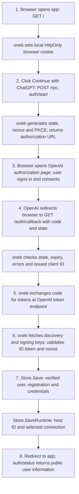
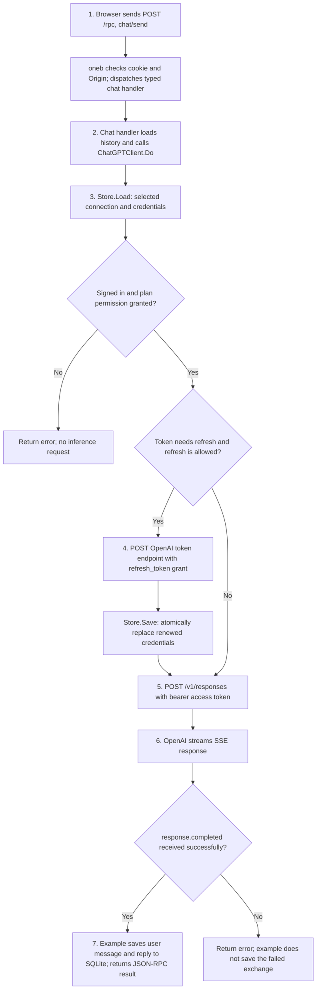

# Auth flow in oneb

These diagrams describe the current local chat example and `oneb.ChatGPTClient` implementation. “Sign up” means connecting/registering this application with a ChatGPT account for the first time; the OpenAI account sign-in/sign-up and consent UI belongs to OpenAI.

## 1. First sign-up / sign-in

At startup, oneb calls `Store.LoadRuntime`. If no runtime exists, it generates a host ID and calls `Store.SaveRuntime`. It reuses the saved host ID on subsequent launches.



Verification checks signature, issuer, audience, token expiration, nonce, and verified subject. For a returning registration, its identity must match the saved connection. Invalid authorization is rejected before any connection is saved. Pending authorization attempts live in memory and expire after ten minutes.

`Connection` stores issuer/subject identity, email, optional name/email-verification claims, client ID, tokens, scopes and renewal timestamps. Access, refresh and ID tokens stay server-side. If identity verification succeeds without ChatGPT plan permission, the connection is saved with `ready=false`; model requests are blocked.

### HTTP requests

`APP` below means `http://127.0.0.1:<port>`.

| Step | Caller → receiver | Request | Important data |
| --- | --- | --- | --- |
| 1 | Browser → app | `GET APP/` | Response sets the local HttpOnly cookie. |
| 2 | Browser → app | `POST APP/rpc` | JSON-RPC method `auth/start`, params `{}`; cookie and matching Origin. |
| 3 | Browser → OpenAI | `GET https://auth.openai.com/api/accounts/authorize` | Authorization query below. |
| 4 | Browser → app | `GET APP/auth/callback` | `code`, `state`, issued `client_id`; or OAuth `error`. |
| 5 | oneb → OpenAI | `POST https://auth.openai.com/api/accounts/oauth/token` | Form-encoded authorization-code grant below. |
| 6 | oneb → OpenAI | `GET https://auth.openai.com/.well-known/openid-configuration` | Discovers issuer and JWKS URL. |
| 6 | oneb → OpenAI | `GET <jwks_uri from discovery>` | Fetches public signing keys when needed for verification. |
| 8 | Browser → app | `GET APP/`, then `POST APP/rpc` | JSON-RPC `auth/status`, params `{}`. |

Authorization query for a new registration:

```text
client_id=dynamic_agent_client
agent_name_hint=<configured app name>
ext_agent_host_id=<persisted host ID>
response_type=code
redirect_uri=APP/auth/callback
scope=openid profile email offline_access resource.invoke chatgpt.tokens.use.direct
resource=https://api.openai.com/v1
state=<random attempt state>
nonce=<random OIDC nonce>
code_challenge_method=S256
code_challenge=<SHA-256 digest of PKCE verifier, base64url encoded>
```

For returning sign-in, oneb uses the saved issued `client_id`, omits `agent_name_hint`, and adds a retained `id_token_hint` when present. The callback can omit `client_id` for that returning registration.

Token exchange form:

```text
grant_type=authorization_code
client_id=<issued client ID>
code=<callback authorization code>
code_verifier=<saved PKCE verifier>
redirect_uri=APP/auth/callback
resource=https://api.openai.com/v1
```

## 2. Request to OpenAI



Refresh is attempted within one minute of expiration, provided `EarliestRefreshAt` has passed. After any refresh, oneb checks plan permission and expiration again before sending the inference request. An expired token, refresh failure, or storage failure stops the request. Concurrent renewals are serialized by the client.

The library owns credentials and authentication; the example owns conversation history, the model/thinking selection, Responses input, SSE parsing and successful-turn persistence.

### HTTP requests

| Step | Caller → receiver | Request | Important data |
| --- | --- | --- | --- |
| 1 | Browser → app | `POST APP/rpc` | JSON-RPC `chat/send`, params `{message, model, reasoning_effort}`; local cookie and matching Origin. |
| 4, if needed | oneb → OpenAI | `POST https://auth.openai.com/api/accounts/oauth/token` | Form: `grant_type=refresh_token`, issued `client_id`, current `refresh_token`, `resource=https://api.openai.com/v1`. |
| 5 | oneb → OpenAI | `POST https://api.openai.com/v1/responses` | `Authorization: Bearer <access_token>` and JSON body below. |

Inference request body:

```json
{
  "model": "gpt-6.1-sol",
  "input": [
    {"role": "user", "content": "Hello"}
  ],
  "reasoning": {"effort": "medium"},
  "store": false,
  "stream": true
}
```

The actual input includes the example's saved history plus the new message. Token refresh and inference run in the backend; the browser never receives provider credentials.

Additional requests used by the example:

| Purpose | Browser → app | Backend → OpenAI |
| --- | --- | --- |
| Populate model picker | `POST APP/rpc`, method `models/list` | `GET https://api.openai.com/v1/models` with bearer token; automatic renewal if necessary. |
| Restore conversation | `POST APP/rpc`, method `chat/history` | None; reads local SQLite. |
| Sign out | `POST APP/rpc`, method `auth/logout` | Discovery GET, then POST to its `revocation_endpoint` with `token=<refresh_token>`, `token_type_hint=refresh_token`, and issued `client_id`. |

`Store` calls are local persistence operations, not HTTP requests in the SQLite example. No user-info request is made: profile fields come from the verified ID token.
